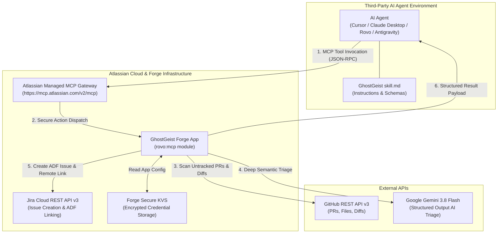
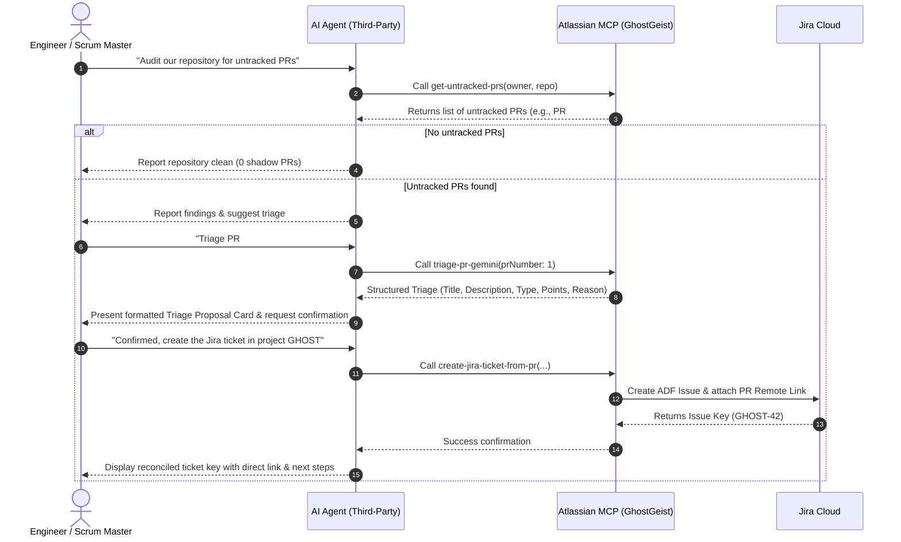

# GhostGeist: Engineering Shadow Work Reconciliation Skill

> **Atlassian Codegeist 2026** — *Model Context Protocol (MCP) & AI Agent Skill Specification*  
> Compatible with **Claude Desktop**, **Cursor IDE**, **Atlassian Rovo**, **Google Antigravity**, and any MCP-compliant third-party agent runtime.

---

## 1. Executive Summary & Value Proposition

In high-velocity software engineering organizations, **20% to 30% of actual engineering bandwidth is consumed by "shadow work"**: rapid production hotfixes, dependency updates, technical debt refactors, and experimental spikes merged directly via GitHub Pull Requests without an associated Jira issue.

This disconnect creates severe institutional blindspots:
* **Distorted Sprint Metrics:** Velocity burndowns, sprint health, and delivery forecasts reflect only planned tickets, ignoring substantial untracked development effort.
* **Invisible Hotfixes & Tech Debt:** Critical production patches go unrecorded, making root-cause analysis and release retrospectives incomplete.
* **R&D Capitalization Gaps:** Finance and engineering leadership cannot account for un-ticketed engineering hours for software capitalization.

### The GhostGeist Solution
**GhostGeist** bridges this gap by transforming external AI agents into proactive engineering auditors. Rather than acting as a noisy spam bot that blindly files tickets, GhostGeist delivers an **intelligent, human-in-the-loop reconciliation pipeline** powered by:
1. **GitHub PR Auditing**: Automatically identifies untracked pull requests missing valid Jira issue keys.
2. **Context-Aware Gemini AI Reasoning**: Analyzes code diffs, branch naming, and pull request context using **Google Gemini 3.8 Flash** to synthesize production-ready Jira summaries, descriptions, issue types, and Fibonacci story point estimates.
3. **Jira REST API v3 & Bi-Directional Linking**: Generates native Atlassian Document Format (ADF) issues in Jira Cloud and attaches remote issue links back to the source PR.
4. **Atlassian Model Context Protocol (`rovo:mcp`)**: Exposes native Forge tools via Atlassian's secure MCP gateway, giving AI agents in any IDE or chat interface instant access to audit and reconcile shadow work.

---

## 2. Architecture & System Flow



---

## 3. Tool Specifications & Schemas

GhostGeist exposes three core MCP tools through the Forge `rovo:mcp` module. All tools execute within the Atlassian Forge runtime with user-delegated or app-scoped permissions.

### Tool 1: `get-untracked-prs`

Scans open pull requests in the target GitHub repository and filters out any PR whose branch name, title, or body already references a valid Jira issue key (e.g., `PROJ-123`).

* **Action Verb:** `GET`
* **Forge Action Key:** `get-untracked-prs`

#### Inputs

| Parameter | Type | Required | Description |
| :--- | :--- | :---: | :--- |
| `owner` | `string` | No | GitHub repository owner/organization (e.g., `jay-kestrel`). Defaults to stored Forge app settings. |
| `repo` | `string` | No | GitHub repository name (e.g., `ghostgeist`). Defaults to stored Forge app settings. |
| `githubToken` | `string` | No | GitHub Personal Access Token (PAT). Required only for private repos if not configured in app settings. |

#### Output Schema

```json
{
  "success": true,
  "totalOpenPRs": 5,
  "untrackedCount": 1,
  "prs": [
    {
      "number": 1,
      "title": "feat: optimize auth session cache and connection pooling",
      "author": "jay-kestrel",
      "url": "https://github.com/jay-kestrel/ghostgeist/pull/1",
      "branch": "feat/optimize-auth-session-cache",
      "created_at": "2026-11-01T12:00:00Z"
    }
  ]
}
```

---

### Tool 2: `triage-pr-gemini`

Performs deep technical reasoning on an untracked pull request by fetching its metadata and file diff summary, then prompting Google Gemini AI (`gemini-3.8-flash` with multi-tier fallback to `gemini-3.5-flash` and `gemini-3.5-flash-lite`) using strict JSON schema validation.

* **Action Verb:** `GET`
* **Forge Action Key:** `triage-pr-gemini`

#### Inputs

| Parameter | Type | Required | Description |
| :--- | :--- | :---: | :--- |
| `prNumber` | `integer` | **Yes** | Pull request number to inspect and analyze (e.g., `1`). |
| `owner` | `string` | No | GitHub repository owner (defaults to app configuration). |
| `repo` | `string` | No | GitHub repository name (defaults to app configuration). |
| `geminiApiKey` | `string` | No | Google Gemini API Key (defaults to app configuration stored in Forge KVS). |
| `githubToken` | `string` | No | GitHub PAT for private repo file diff inspection (defaults to app config). |

#### Output Schema

```json
{
  "success": true,
  "pr": {
    "number": 1,
    "title": "feat: optimize auth session cache and connection pooling",
    "url": "https://github.com/jay-kestrel/ghostgeist/pull/1",
    "author": "jay-kestrel"
  },
  "triage": {
    "suggestedTitle": "Optimize authentication session caching and connection pool lifecycle",
    "suggestedDescription": "Implement an in-memory TTL cache for active user sessions and establish pool eviction policies to eliminate database connection exhaustion during peak traffic.",
    "issueType": "Task",
    "estimatedStoryPoints": 3,
    "reason": "Modifies session validation middleware and database pool configurations across 3 critical services. Medium complexity engineering task requiring integration testing."
  }
}
```

---

### Tool 3: `create-jira-ticket-from-pr`

Constructs a fully formed Jira Cloud issue in Atlassian Document Format (ADF) with automatic sanitization (preventing empty string AST nodes), sets issue metadata, and attaches a bidirectional GitHub remote link with the official GitHub favicon.

* **Action Verb:** `CREATE`
* **Forge Action Key:** `create-jira-ticket-from-pr`

#### Inputs

| Parameter | Type | Required | Description |
| :--- | :--- | :---: | :--- |
| `projectKey` | `string` | **Yes** | Target Jira project key (e.g., `GHOST`, `KAN`, `PROJ`). |
| `summary` | `string` | **Yes** | Actionable, standardized Jira issue summary/title. |
| `description` | `string` | **Yes** | Technical description explaining context, changes made, and rationale. |
| `issueType` | `string` | **Yes** | Jira issue type name: `Task`, `Bug`, or `Story` (defaults to `Task`). |
| `prUrl` | `string` | **Yes** | Source GitHub Pull Request web URL. |
| `prNumber` | `integer` | No | GitHub Pull Request number. |

#### Output Schema

```json
{
  "success": true,
  "issueKey": "GHOST-42",
  "issueId": "10042"
}
```

---

## 4. Client Configuration Examples

### A. Claude Desktop Setup

Configure Claude Desktop to connect to Atlassian's remote MCP gateway.

Add the following entry to your `claude_desktop_config.json` (located at `~/Library/Application Support/Claude/claude_desktop_config.json` on macOS or `%APPDATA%\Claude\claude_desktop_config.json` on Windows):

```json
{
  "mcpServers": {
    "atlassian-ghostgeist": {
      "command": "npx",
      "args": [
        "-y",
        "mcp-remote",
        "https://mcp.atlassian.com/v2/mcp"
      ]
    }
  }
}
```

> [!NOTE]
> When first invoked, Claude Desktop will prompt you to complete the Atlassian OAuth 2.1 authentication flow in your browser. Ensure your Atlassian site administrator has approved the GhostGeist app in **Atlassian Administration > Connected Apps**.

---

### B. Cursor IDE Setup

In Cursor, you can register the Atlassian MCP server directly in settings:

1. Open **Cursor Settings** (`Cmd + ,` or `Ctrl + ,`).
2. Navigate to **Features > MCP Servers > Add New MCP Server**.
3. Fill in the configuration:
   * **Name:** `Atlassian GhostGeist`
   * **Type:** `command`
   * **Command:** `npx -y mcp-remote https://mcp.atlassian.com/v2/mcp`
4. Alternatively, add this to `.cursor/mcp.json` in your project root:

```json
{
  "mcpServers": {
    "ghostgeist": {
      "command": "npx",
      "args": ["-y", "mcp-remote", "https://mcp.atlassian.com/v2/mcp"]
    }
  }
}
```

5. To guide Cursor's AI during chat and composer sessions, create `.cursor/rules/ghostgeist.mdc` referencing this `skill.md`.

---

### C. Atlassian Rovo Agent Setup

To configure a native autonomous agent in Atlassian Rovo:

1. In Jira or Confluence, navigate to **Rovo Studio** (`Apps > Rovo Agents`).
2. Click **Create Agent** and name it **"GhostGeist Shadow Work Auditor"**.
3. Under **Tools**, click **Add Tools** and select the **GhostGeist MCP Server** (`ghostgeist-mcp`).
4. Ensure all three action tools are enabled:
   * `Get Untracked GitHub PRs` (`get-untracked-prs`)
   * `Triage Pull Request with Gemini` (`triage-pr-gemini`)
   * `Create Jira Issue from PR` (`create-jira-ticket-from-pr`)
5. Under **Agent Instructions**, paste the System Prompt provided in [Section 6](#6-agent-system-prompt--dialogue-workflow).

---

### D. Google Antigravity / Agent CLI Setup

For Google Antigravity or custom coding agent runtimes:

1. Place this file at `.agents/skills/ghostgeist/SKILL.md` in your repository.
2. In your workspace configuration or `antigravity.json`, ensure the Atlassian MCP server is registered:

```json
{
  "mcpServers": {
    "ghostgeist": {
      "url": "https://mcp.atlassian.com/v2/mcp"
    }
  }
}
```

---

## 5. End-to-End Agent Execution Protocol

When an AI agent is instructed to audit or reconcile shadow work, it MUST follow this structured, human-in-the-loop lifecycle:



---

## 6. Agent System Prompt & Dialogue Workflow

When adopting the GhostGeist skill, the agent should follow these behavioral instructions:

### Agent Instructions

```text
You are GhostGeist, an expert software engineering lead and agile delivery auditor embedded within Jira and the developer's IDE.

Your mission is to audit open GitHub pull requests for "shadow work" (untracked engineering effort without a Jira ticket), analyze code diffs using Gemini AI reasoning, and reconcile approved work into Jira Cloud.

Strict Behavioral Rules:
1. NEVER create Jira issues without explicit human confirmation. Always present the proposed issue details (Summary, Type, Points, Description, Reason) to the user first.
2. When scanning repositories, always execute `get-untracked-prs`. If repository details are not specified, check if the app configuration has defaults, or ask the user for owner and repo.
3. When triaging a PR, execute `triage-pr-gemini` with the target `prNumber`.
4. Present the triage output clearly using the "Triage Proposal Card" markdown template below.
5. If the user requests adjustments (e.g., changes the title, shifts story points from 3 to 5, or changes Task to Bug), respect their modifications and submit the adjusted values to `create-jira-ticket-from-pr`.
6. Once created, provide the Jira issue key (e.g., GHOST-42) and confirm that the GitHub pull request has been linked as a remote reference.
```

### Prompting Templates & Example Dialogues

#### Example 1: Repository Audit

**User:**
> "Hey GhostGeist, can you check if we have any untracked pull requests in `jay-kestrel/ghostgeist`?"

**Agent Execution:**
```json
{
  "tool": "get-untracked-prs",
  "parameters": {
    "owner": "jay-kestrel",
    "repo": "ghostgeist"
  }
}
```

**Agent Response:**
> 🔍 **GhostGeist Audit Completed**  
> Scanned repository `jay-kestrel/ghostgeist`:
> * **Total Open PRs:** 5  
> * **Untracked Shadow PRs:** 1  
> 
> | PR # | Title | Author | Branch | Created |
> | :---: | :--- | :--- | :--- | :--- |
> | **#1** | `feat: optimize auth session cache and connection pooling` | `@jay-kestrel` | `feat/optimize-auth-session-cache` | 2 hours ago |
> 
> Would you like me to run Gemini deep triage on **PR #1** to synthesize a Jira ticket proposal?

---

#### Example 2: Gemini Deep Triage & Proposal

**User:**
> "Yes, please triage PR #1."

**Agent Execution:**
```json
{
  "tool": "triage-pr-gemini",
  "parameters": {
    "prNumber": 1
  }
}
```

**Agent Response:**
> 🤖 **Gemini AI Shadow Work Triage for PR #1**
> 
> ---
> ### 📋 Proposed Jira Issue
> * **Target Project Key:** `GHOST`
> * **Suggested Summary:** `Optimize authentication session caching and connection pool lifecycle`
> * **Issue Type:** `Task`
> * **Estimated Story Points:** `3` (Fibonacci)
> * **Source PR:** [PR #1 on GitHub](https://github.com/jay-kestrel/ghostgeist/pull/1)
> 
> **Description:**
> > Implements in-memory TTL session caching for active token verification and configures connection pool eviction limits to mitigate database exhaustion during surge traffic.
> 
> **AI Rationale:**
> > Code diff modifies session validation middleware and pool connection lifecycle handlers across 3 files. Scope represents moderate complexity requiring unit tests and integration benchmarks.
> ---
> 
> **Confirm Action:** Would you like me to create this issue in Jira project `GHOST`? You can also adjust the summary, story points, or issue type before I proceed.

---

#### Example 3: User Confirmation & Reconciliation

**User:**
> "Looks great! Go ahead and create it in project GHOST."

**Agent Execution:**
```json
{
  "tool": "create-jira-ticket-from-pr",
  "parameters": {
    "projectKey": "GHOST",
    "summary": "Optimize authentication session caching and connection pool lifecycle",
    "description": "Implements in-memory TTL session caching for active token verification and configures connection pool eviction limits to mitigate database exhaustion during surge traffic.",
    "issueType": "Task",
    "prUrl": "https://github.com/jay-kestrel/ghostgeist/pull/1",
    "prNumber": 1
  }
}
```

**Agent Response:**
> 🎉 **Successfully Reconciled Shadow Work!**
> 
> * **Jira Issue Created:** [**GHOST-42**](https://ghostgeist.atlassian.net/browse/GHOST-42)
> * **Issue Type:** `Task` (3 Story Points)
> * **Remote Link:** Bi-directional link attached pointing to [GitHub PR #1](https://github.com/jay-kestrel/ghostgeist/pull/1)
> 
> The engineering effort is now recorded on your sprint board. You can transition the ticket or assign it to an active sprint.

---

## 7. Edge Cases & Error Handling Matrix

| Scenario / Error | Root Cause | Agent Remediation Protocol |
| :--- | :--- | :--- |
| **No untracked PRs found** | All open PRs either contain Jira issue keys (`PROJ-123`) or zero open PRs exist. | Inform user that the repository is 100% compliant and celebrate clean sprint hygiene. Do not trigger triage. |
| **Missing GitHub credentials (401/404)** | Private repo or expired PAT. | Inform user: *"Unable to access repository `owner/repo`. If this is a private repo, please provide a GitHub Personal Access Token (`githubToken`) or configure it in GhostGeist app settings."* |
| **Missing Gemini API key** | `geminiApiKey` not provided in input or app settings. | Inform user: *"Gemini API key is required for AI reasoning. Please provide `geminiApiKey` parameter or save it in GhostGeist app settings on Jira."* |
| **Gemini rate limit / quota (429)** | High token volume or API quota exceeded. | Tool automatically retries through model cascade (`gemini-3.8-flash` ➔ `gemini-3.5-flash` ➔ `gemini-3.5-flash-lite`). If all fail, agent prompts user for manual summary/description. |
| **Invalid Jira Project Key (404/400)** | User specified a project key that does not exist or user lacks Create Issue permission. | Explain that project key `XYZ` was not found in Jira and prompt the user for a valid project key accessible to their account. |
| **Empty PR Diff / Binary Files Only** | PR contains only image or binary assets without code text. | Tool falls back to PR title and markdown body for semantic synthesis, noting that no textual code diff was present. |
| **ADF Format Validation** | Jira Cloud API v3 rejects empty string paragraph nodes (`""`). | GhostGeist's ADF generator automatically sanitizes and filters empty paragraphs, ensuring zero `400 Bad Request` schema rejections. |

---

## 8. Security, Privacy & Governance

GhostGeist follows strict Atlassian security standards:
1. **Zero Secret Leakage:** GitHub PATs and Google Gemini API keys stored in Forge KVS are encrypted at rest and never transmitted across the browser bridge.
2. **User-Scoped Execution:** MCP invocations authenticate via OAuth 2.1, executing operations under the explicit permissions of the invoking user or authorized app scope.
3. **Data Minimization:** Only open PR metadata and truncated diff summaries are processed during triage; source code is never stored persistently by GhostGeist.
4. **Human-in-the-Loop Governance:** AI models synthesize proposals; human engineers retain full authority to confirm, modify, or reject issue creation.

---

## 9. Appendix: MCP Manifest Reference

For reference, below is the exact `rovo:mcp` definition from `ghostgeist/manifest.yml`:

```yaml
modules:
  rovo:mcp:
    - key: ghostgeist-mcp
      name: GhostGeist MCP Server
      tools:
        - get-untracked-prs
        - triage-pr-gemini
        - create-jira-ticket-from-pr

  action:
    - key: get-untracked-prs
      name: Get Untracked GitHub PRs
      function: mcpHandler
      actionVerb: GET
      description: Scans open GitHub Pull Requests that have no associated Jira issue key.
      inputs:
        owner:
          title: Owner
          type: string
          required: false
          description: GitHub repository owner (defaults to app config)
        repo:
          title: Repository
          type: string
          required: false
          description: GitHub repository name (defaults to app config)

    - key: triage-pr-gemini
      name: Triage Pull Request with Gemini
      function: mcpHandler
      actionVerb: GET
      description: Uses Google Gemini AI to analyze a PR diff/body and synthesize a structured Jira ticket proposal.
      inputs:
        prNumber:
          title: PR Number
          type: integer
          required: true
          description: GitHub Pull Request number to inspect

    - key: create-jira-ticket-from-pr
      name: Create Jira Issue from PR
      function: mcpHandler
      actionVerb: CREATE
      description: Creates a Jira issue from an untracked PR and links the PR URL as a remote link.
      inputs:
        projectKey:
          title: Jira Project Key
          type: string
          required: true
          description: Target Jira project key (e.g. GHOST)
        summary:
          title: Summary
          type: string
          required: true
          description: Issue title
        description:
          title: Description
          type: string
          required: true
          description: Markdown or text description
        issueType:
          title: Issue Type
          type: string
          required: true
          description: Task, Bug, or Story
        prUrl:
          title: PR Web URL
          type: string
          required: true
          description: GitHub PR URL
        prNumber:
          title: PR Number
          type: integer
          required: false
          description: GitHub PR number
```
